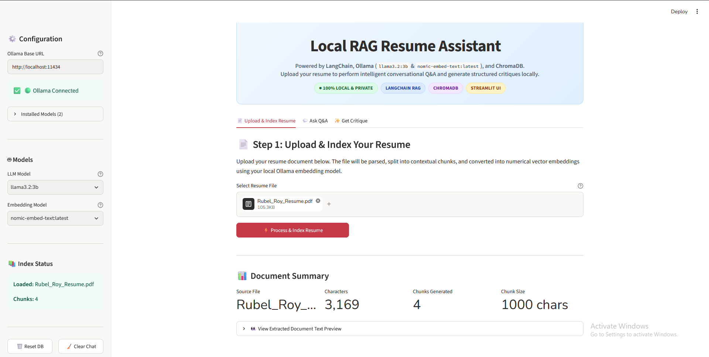
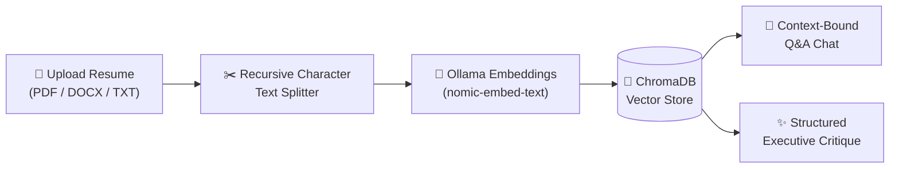

<div align="center">

# 📄 Local RAG Resume Assistant

### A 100% Local, Privacy-First Resume Intelligence Engine & Career Consultant

[](https://www.python.org/)
[](https://streamlit.io/)
[](https://python.langchain.com/)
[](https://ollama.com/)
[](https://www.trychroma.com/)
[](LICENSE)

<br>

[[](https://github.com/coder-d-Eyeden/Local-RAG-Resume-Assistant/blob/main/assets/Image.png)](https://github.com/coder-d-Eyeden/Local-RAG-Resume-Assistant/blob/main/assets/Image.png)

<br><br>

**Upload your resume (PDF, DOCX, TXT), index it into a persistent vector database, and perform intelligent semantic Q&A and structured executive career critiques—completely offline on your own machine.**

[Quick Start](#-quick-start) • [Architecture](#-architecture--file-structure) • [Features](#-key-features) • [Configuration](#-configuration) • [Troubleshooting](#-troubleshooting--faq)

</div>

---

## 📖 Overview

The **Local RAG Resume Assistant** is a production-grade demonstration of **Retrieval-Augmented Generation (RAG)** applied to document analysis. It bridges local small language models (like **Llama 3.2 3B**) and local embedding models with high-speed vector retrieval to deliver deep, context-bounded resume analysis without sending a single byte of your sensitive career data to the cloud.

### Core Capabilities
1. **💬 Interactive Conversational Q&A**: Ask targeted questions regarding specific skills, timelines, job roles, or metrics. Responses stream in real-time and are strictly grounded in your resume text.
2. **✨ Structured Executive Critique**: Receive a structured career evaluation covering strengths, key achievements, areas for enhancement, market confidence level, and recommended career trajectories with one-click Markdown export.
3. **💾 100% Local & Persistent**: Embedded vectors are preserved across sessions in a local ChromaDB instance with a one-click database reset directly in the UI.

---

## 🏗️ Architecture & File Structure

The project follows a clean separation of concerns:

```text
rag-assistant/
│
├── config/                         # Application configuration & presets
│   ├── __init__.py
│   └── settings.py                 # Central settings (Ollama URL, model defaults, chunking)
│
├── core/                           # Core RAG engine & business logic
│   ├── __init__.py
│   ├── llm.py                     # Ollama connection, model discovery & tag normalization
│   ├── document_loader.py         # Multi-format document parser (PDF, DOCX, TXT) with fallbacks
│   ├── vector_store.py            # ChromaDB management, memory-mapped cleanup & persistence
│   ├── rag_chain.py               # RAG prompt pipeline with token streaming
│   └── critique.py                # Structured resume evaluation prompt & JSON parser
│
├── ui/                            # Streamlit frontend views and components
│   ├── __init__.py
│   ├── styles.py                  # Custom responsive CSS and Nunito typography
│   ├── components.py              # Header hero, diagnostic sidebar & metric cards
│   └── views/                     # Tabbed modular views
│       ├── __init__.py
│       ├── upload_view.py         # Step 1: Ingestion, chunking & vector indexing
│       ├── chat_view.py           # Step 2: Interactive Q&A chat with quick suggestions
│       └── critique_view.py       # Step 3: Structured critique report & export
│
├── assets/                        # Visual assets and diagrams
├── app.py                         # Streamlit application entrypoint
├── requirements.txt               # Python dependencies
├── README.md                      # Project documentation
└── .gitignore                     # Git ignore rules (virtualenvs, cache, chroma_db/)
```

---

## ✨ Key Features

- **🛡️ 100% Private & Offline**: Powered by Ollama. No third-party API keys, subscriptions, or cloud uploads required.
- **⚡ Smart Model Discovery & Sync**: Automatically queries your running Ollama server for installed models (prioritizing `llama3.2:3b`) and dynamically synchronizes the active RAG chain when changing models in the sidebar.
- **📄 Resilient Multi-Format Ingestion**:
  - **PDF**: Pure-Python extraction via `pypdf`.
  - **DOCX**: Native document and table parsing via `python-docx`.
  - **TXT / MD**: Multi-encoding fallback support (UTF-8, Latin-1, CP1252).
  - Optional zero-config integration with the `unstructured` library.
- **🧠 ChromaDB Persistent Storage**: Vectors stay persisted on disk (`./chroma_db`) between runs. Includes clean cache purging to safely wipe database files on Windows without process lock issues.
- **🌊 Real-Time Token Streaming**: Watch the assistant formulate answers progressively using Streamlit's native streaming capabilities.
- **📊 Metric Dashboard**: Instant feedback displaying total character count, number of generated chunks, chunk overlap, and preview of extracted text.

---

## ⚙️ Prerequisites

Before launching the application, ensure you have the following installed:

### 1. Ollama Runtime
Download and install [Ollama](https://ollama.com/) for your operating system (macOS, Windows, or Linux).

Ensure the Ollama background service is running:
```bash
ollama serve
```

Pull the recommended generation model and embedding model:
```bash
# Recommended fast 3B LLM (ideal for laptops and CPUs)
ollama pull llama3.2:3b

# High-performance embedding model
ollama pull nomic-embed-text
```

*(You can also use other models such as `llama3`, `llama3.1`, `mistral`, `qwen2.5`, or `all-minilm`)*

### 2. Python 3.9+
Verify your Python installation:
```bash
python --version
```

---

## 🚀 Quick Start

### 1. Clone the Repository
```bash
git clone https://github.com/your-username/rag-assistant.git
cd rag-assistant
```

### 2. Set Up a Virtual Environment

**Using Conda (Recommended):**
```bash
conda create -n rag python=3.11 -y
conda activate rag
```

**Using standard Python venv:**
```bash
# Windows
python -m venv venv
.\venv\Scripts\activate

# macOS / Linux
python3 -m venv venv
source venv/bin/activate
```

### 3. Install Dependencies
```bash
pip install -r requirements.txt
```

### 4. Run the Application
```bash
streamlit run app.py
```

The application will launch and open in your default browser at `http://localhost:8501`.

---

## 🧑‍💻 Application Workflow



### Step 1: Upload & Index
1. Navigate to the **📄 Upload & Index Resume** tab.
2. Drag and drop your resume (`.pdf`, `.docx`, `.txt`, `.md`).
3. Click **⚡ Process & Index Resume**.
4. View real-time chunking metrics and expand the preview card to inspect extracted document text.

### Step 2: Interactive Q&A
1. Switch to the **💬 Ask Q&A** tab.
2. Select any **Suggested Question** pill (e.g. *"What are the candidate's core technical skills?"*) or type your custom prompt in the chat input.
3. The LLM retrieves the top 5 most relevant resume chunks and streams a factual answer strictly grounded in the resume.

### Step 3: Structured Critique
1. Go to the **✨ Get Critique** tab.
2. Click **✨ Generate Critique**.
3. The LLM acts as an executive career consultant, outputting:
   - **Overall Assessment & Tone Rating** (e.g., 🏆 *Excellent*, ⭐ *Strong*).
   - **Market Confidence Level**.
   - **Summary of Strengths** and **Standout Highlights**.
   - **Constructive Areas for Enhancement** (smartly suppressed if the profile is already top-tier).
   - **Suggested Career Pathway**.
4. Click **📥 Download Critique Report (.md)** to save the evaluation locally.

---

## 🛠️ Configuration

You can customize defaults by editing [`config/settings.py`](config/settings.py) or by passing environment variables:

| Variable | Default Value | Description |
|---|---|---|
| `OLLAMA_BASE_URL` | `http://localhost:11434` | Ollama server REST endpoint |
| `LLM_MODEL` | `llama3.2:3b` | Default LLM for response and critique generation |
| `EMBEDDING_MODEL` | `nomic-embed-text` | Embedding model for converting text chunks into vectors |
| `VECTOR_DB_DIR` | `./chroma_db` | Disk directory for ChromaDB SQLite and HNSW persistence |
| `CHUNK_SIZE` | `1000` | Target character count per document chunk |
| `CHUNK_OVERLAP` | `200` | Overlap character count between consecutive chunks |
| `RETRIEVER_K` | `5` | Top-$k$ document chunks retrieved per user question |

---

## ❓ Troubleshooting & FAQ

<details>
<summary><b>1. "Model not found" or model dropdown mismatch</b></summary>
<br>
If you pulled <code>llama3.2:3b</code> via terminal, make sure Ollama is running. The sidebar automatically discovers your installed tags. If you manually type a tag like <code>llama3.2</code>, the app's internal resolver automatically maps it to <code>llama3.2:3b</code>.
</details>

<details>
<summary><b>2. Reset DB doesn't delete files on Windows</b></summary>
<br>
ChromaDB uses C++ memory-mapped index files (<code>data_level0.bin</code>). When you click <b>🗑️ Reset DB</b>, the application closes open client references and purges the <code>SharedSystemClient</code> cache to release Windows file locks before deleting the folder from disk. If a server process is ever forcefully killed, you can safely delete the <code>chroma_db</code> directory manually from your file explorer.
</details>

<details>
<summary><b>3. VS Code shows "Cannot find module langchain_core" warning</b></summary>
<br>
This occurs if your VS Code Python extension defaults to the <code>base</code> conda environment instead of your dedicated <code>rag</code> environment.
<br><br>
<b>Fix:</b> In VS Code, press <kbd>Ctrl</kbd> + <kbd>Shift</kbd> + <kbd>P</kbd>, choose <b>Python: Select Interpreter</b>, and select the environment pointing to <code>.../envs/rag/python.exe</code>.
</details>

<details>
<summary><b>4. Ollama connection refused</b></summary>
<br>
Verify that Ollama is running in the background. On Windows/macOS, check for the Ollama icon in your system tray, or run <code>ollama serve</code> in a new terminal window.
</details>

---

## 📜 License

This project is licensed under the [MIT License](LICENSE). You are free to modify, distribute, and integrate this project in commercial and private applications.
